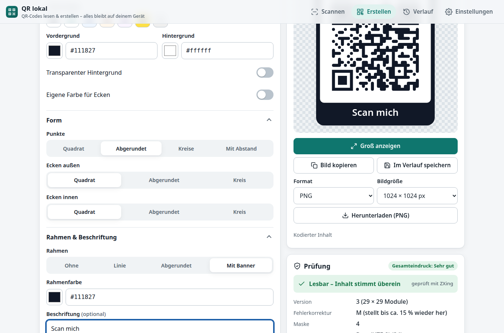
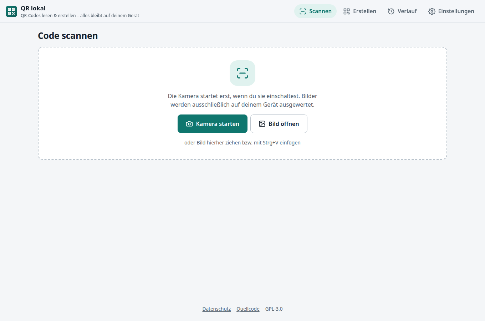
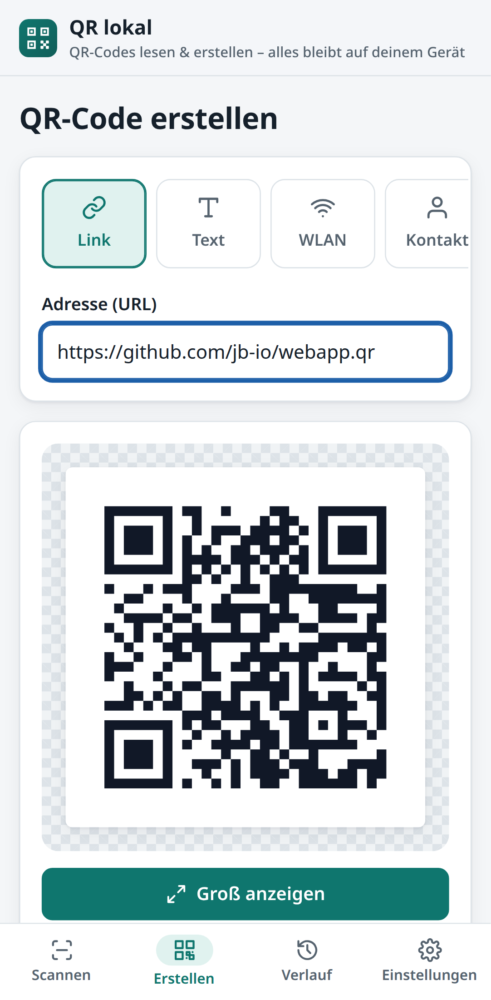
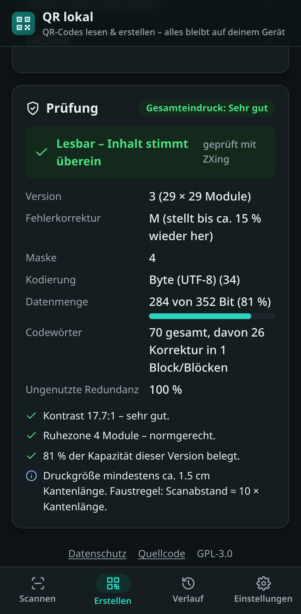
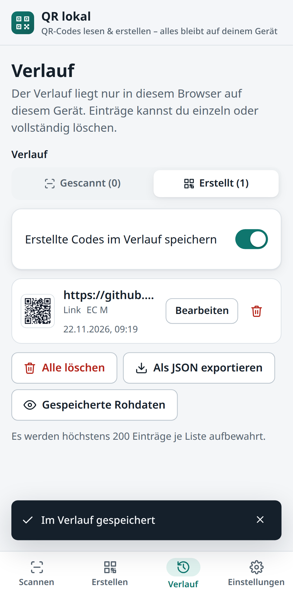

# QR lokal

QR-Codes scannen und erstellen – vollständig in deinem Browser. Keine Cookies,
kein Tracking, keine Werbung, keine Anmeldung und **keine einzige Anfrage an
fremde Server**. Kostenlos und quelloffen.

**Direkt ausprobieren:** <https://jb-io.github.io/webapp.qr/>



*English summary: QR lokal ("QR local") is a privacy-friendly QR code scanner
and generator that runs entirely in the browser – no cookies, no tracking, no
external requests (enforced by a Content Security Policy). It works on desktop
and mobile browsers and installs as an offline-capable PWA with Android
share-target support. The UI is available in German and English.*

---

## Was kann die App?

### Scannen

- Die **Kamera startet erst auf deinen Klick** und stoppt sofort nach einem
  Treffer, beim Verlassen der Seite oder wenn die App in den Hintergrund geht.
- Alternativ ein **Bild öffnen**, per Drag & drop ablegen, mit Strg+V einfügen
  oder – als installierte App unter Android – aus einer anderen App **teilen**.
- Erkannt werden QR-Codes und praktisch alle gängigen 1D-/2D-Codes
  (EAN/UPC, Code 128/39/93, ITF, Codabar, Data Matrix, Aztec, PDF417, Micro QR,
  rMQR, MaxiCode, DataBar …).
- Das Ergebnis wird **zuerst angezeigt** – passende Aktionen bietet die App
  danach an: Link öffnen, anrufen, SMS/E-Mail schreiben, Kontakt (.vcf) oder
  Termin (.ics) speichern, Ort in der Karten-App öffnen, WLAN-Passwort oder
  IBAN kopieren, teilen – oder den Inhalt **bearbeiten und als neuen Code
  erstellen**.
- Links werden auf typische Tricks geprüft: unverschlüsseltes http,
  Punycode-Domains, IP-Adressen, Zugangsdaten vor dem Host, Kurzlinks,
  gefährliche Schemata wie `javascript:`. Der echte Zielserver wird
  hervorgehoben.



### Erstellen

- Inhaltstypen: **Link, Text, WLAN, Kontakt (vCard), E-Mail, Telefon, SMS,
  Ort, Termin, Überweisung (GiroCode/EPC)** – mit Prüfung der Eingaben (z. B.
  IBAN-Prüfsumme, WPA-Passwortlänge).
- Gestaltung: Farben (inkl. Vorlagen und eigener Eckfarbe), transparenter
  Hintergrund, Punktform, Form der Ecken, **Rahmen mit oder ohne
  Beschriftung**, **Logo/Bild in der Mitte**.
- Technik: Fehlerkorrektur L/M/Q/H, Mindest-Version, Maskenmuster,
  Ruhezone.
- Ausgabe: **Großanzeige** zum direkten Abscannen (Bildschirm bleibt an),
  Download als **PNG, SVG, PDF, JPEG, WebP**, Bild kopieren oder am Handy
  über das **Teilen-Menü** weitergeben.
- Jeder erzeugte Code wird **sofort mit einem unabhängigen Scanner erneut
  gelesen**. Angezeigt werden Lesbarkeit, Version und Größe, Fehlerkorrektur,
  Maske, Kodierung, Datenmenge, Codewörter, ungenutzte Redundanz sowie Hinweise
  zu Kontrast, Ruhezone, Logo-Abdeckung und Mindest-Druckgröße.

<p>
  
  
  
</p>

### Teilen unter Android

Ist die App installiert (Browser-Menü → „App installieren“ bzw. „Zum
Startbildschirm hinzufügen“), erscheint sie im Teilen-Menü:

- **Text oder Link** teilen → landet im passenden Formular.
- **Kontakt (.vcf)** oder **Termin (.ics)** teilen → wird als Kontakt- bzw.
  Termin-Formular übernommen.
- **Bild** teilen → wird nach Codes durchsucht.

Geteilte Daten kannst du vor dem Erstellen in Ruhe **anpassen**.

### Verlauf – transparent und löschbar

Gescannte und erstellte Codes landen im Verlauf, **nur im Speicher deines
Browsers**. Du kannst einzelne Einträge oder alles löschen, den Verlauf als
JSON exportieren und dir die **gespeicherten Rohdaten** genau so anzeigen
lassen, wie sie im Browser liegen. Speichern lässt sich für beide Listen
getrennt abschalten.

## Datenschutz

- Alles läuft lokal; Kamera- und Bilddaten verlassen das Gerät nie.
- Eine strenge **Content-Security-Policy** verbietet dem Browser jede Anfrage
  an andere Server – auch die Scanner-Engine (WebAssembly) wird mitgeliefert
  statt von einem CDN geladen. Die automatischen Tests schlagen fehl, sobald
  eine Anfrage die eigene Adresse verlässt.
- Keine Cookies, keine Analyse, keine Schriften oder Skripte von Dritten.
- Gehostet auf GitHub Pages – siehe [Datenschutzerklärung](https://jb-io.github.io/webapp.qr/#/privacy).

## Selbst betreiben

Du brauchst [Node.js](https://nodejs.org) 22.18 oder neuer.

```bash
npm install
npm run dev          # Entwicklungsserver auf http://localhost:3000
npm run build        # Typprüfung + Build nach dist/
npm run preview      # dist/ ausliefern
```

`dist/` ist eine rein statische Seite und läuft auf jedem Webserver, auch in
einem Unterverzeichnis. Für Kamera und Offline-Betrieb ist HTTPS nötig
(`localhost` zählt als sicher).

## Für Entwickler

```bash
npm test             # Unit-Tests (node:test, src/core)
npm run test:e2e     # Playwright gegen den Produktions-Build (Desktop + Mobil)
npm run screenshots  # Bilder dieser README neu erzeugen (Preview muss laufen)
```

Architektur und Entscheidungen: [Architecture.md](Architecture.md),
Arbeitsanweisungen: [CLAUDE.md](CLAUDE.md).

## Lizenz

[GPL-3.0](LICENSE). Verwendete Bibliotheken: [React](https://react.dev),
[node-qrcode](https://github.com/soldair/node-qrcode) (Erzeugung),
[zxing-wasm](https://github.com/Sec-ant/zxing-wasm) /
[zxing-cpp](https://github.com/zxing-cpp/zxing-cpp) (Erkennung und Prüfung).
